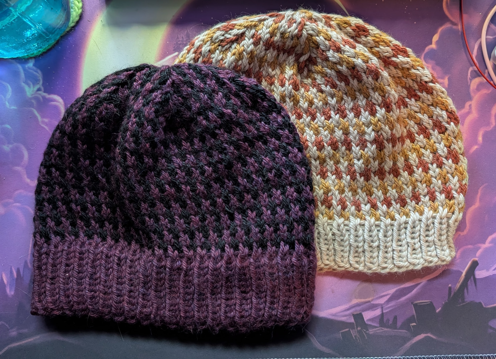
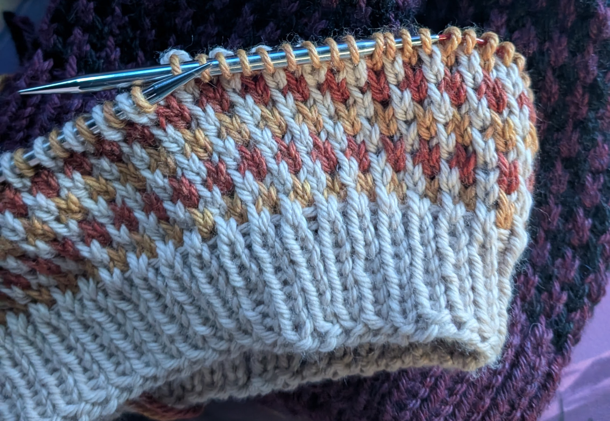

I can't remember the last time I followed a pattern exactly. Often patterns are just suggestions or guides for me, not must-follow instructions; a gauge swatch is a test of fabric drape and density used to calculate the real numbers I'll need against a pattern's own gauge; sweater lengths and pattern repeats and charts are ideas to be taken, adapted, and occasionally discarded.

And yet I have never come up with my own pattern, 100% completely from scratch in over 20 years of knitting and crocheting.

That is, until now.

The **Scrappy Slip Stitch Hat** was born out of my desire to use the last of my Berroco Vintage Chunky to make some hats with a simple pattern that only required the use of one color at a time. It requires only a small amount of yarn and a consistent main color; although, really, you don't even need that -- it is, after all, scrappy; switch yarn colors every two rows if that's what you see fit. It also incorporates the pattern into the crown shaping, which was easy now that I think of it, but I still feel oddly proud of.

So if you, too, have some bulky scrap yarn and a desire for a hat, here are my instructions: Follow them as much or as little as you need.

My hats came to about 9" width when laid flat, unstretched. They comfortably fit my 21.5" head and I've got about 3-4" of give left in there. I'd estimate they could comfortably fit heads 20-25 inches in size.

## Gauge

18 stitches per 4 inches x 24 rows per 4 inches (it's the slip stitches!)

## Supplies

### Bulky Yarn

I used 73 grams/100 yards purple and 62 grams/44 yards black for my purple and black hat with the folded brim.

I used 50 grams/68 yards mushroom (that undyed cream color), and 19 grams/24 yards of each of the oranges for the mushroom and orange hat with the regular brim.

### Knitting Needles

- 10 US / 6.0 mm 16" circulars or DPNs for the brim
- 10.5 US / 6.5 mm 16" circulars or DPNs for the head; if using circulars you will need to switch to DPNs, use magic loop with a longer cable, or add a second set of 10.5 circulars for the crown

## The Pattern

### Ribbing

**Size 10 needles**

1. Cast on 86 stitches with the main color (MC)
2. Knit ribbing (k1, p1) for desired length, keeping track of how many rows you have knit if you want a folded brim. If *not* knitting a folded brim, stop at your desired length. (I knit 10 rows for my purple hat; 7 for the mushroom.)
3. **Folded brim only:** Purl 1 row
4. **Folded brim only:** Knit ribbing (k1, p1) again for the same amount of rows as prior to the purl row (i.e., I knit 10 rows for my purple hat with the folded brim)
5. **Folded brim only:** Knit one more row of ribbing, when at a knit stitch, pick up the cast on edge of the stitch at the bottom of the row (it will look like a purl from the back); knit the two stitches together.

### Head

**Switch to size 10.5 needles (if you want, I forgot for the mushroom hat)**

Starting with the contrast color, repeat the following until you want to begin crown decreases:

**Row 1 (CC):** (Slip1 k1) to end

**Row 2 (CC):** Knit

**Row 3 (MC):** (k1 slip 1)to end

**Row 4: (MC):** Knit

End after a row 1 repeat.

### Crown

**Row 1 (CC):** K7 k3tog (k11 k3tog) 5 times k6 (74 stitches)

**Row 2 (MC):** Knit in pattern

**Row 3 (MC):** K6 k3tog (k9 k3tog) 5 times k5 (62)

**Row 4 (CC):** Knit in pattern

**Row 5 (CC):** K5 k3tog (k7 k3tog) 5 times k4 (50)

**Row 6 (MC):** Knit in pattern

**Row 7(MC):** K4 k3tog (k5 k3tog) 5 times k3 (38)

**Row 8 (CC):** Knit in pattern

**Row 9 (CC):** (k3 k3tog) 6 times k2 (26)

**Row 10 (MC):** Knit in pattern

**Row 11 (MC):** K2 k3tog (k1 k3tog) 5 times k1 (14)

**Row 12 (CC):** Knit in pattern

**Row 13 (CC):**  (k2togbl k2tog) to end (7)

Cut both threads and pull through loops; weave in ends.

---

And that's it! Eventually I plan on grading this to have a larger and smaller version, upon which I'll maybe run a small test (just to test running a pattern test), and release it as a PDF pattern on Ravelry. But until then: Enjoy! And be sure to ping me on Ravelry if you use the pattern!

**Projects in this post:**
- [Scrappy Slip Stitch Hat - Purple & Black ](https://www.ravelry.com/projects/Acanthae/scrappy-slip-stitch-hat---purple--black)
- [Scrappy Slip Stitch Hat - Autumn](https://www.ravelry.com/projects/Acanthae/scrappy-slip-stitch-hat---autumn) 